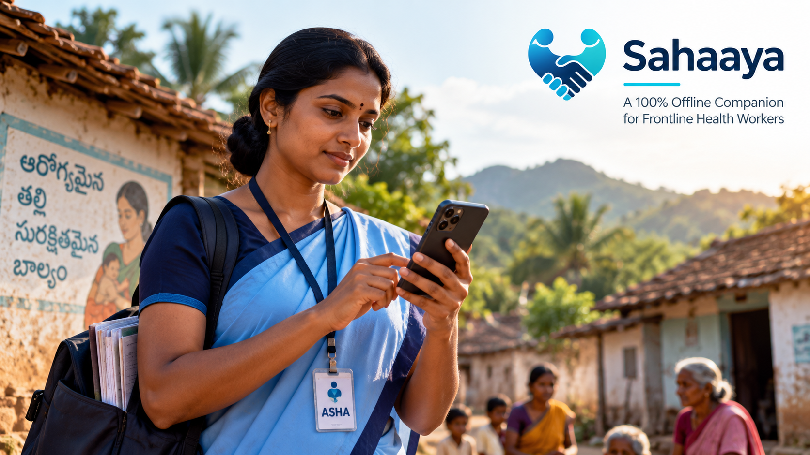
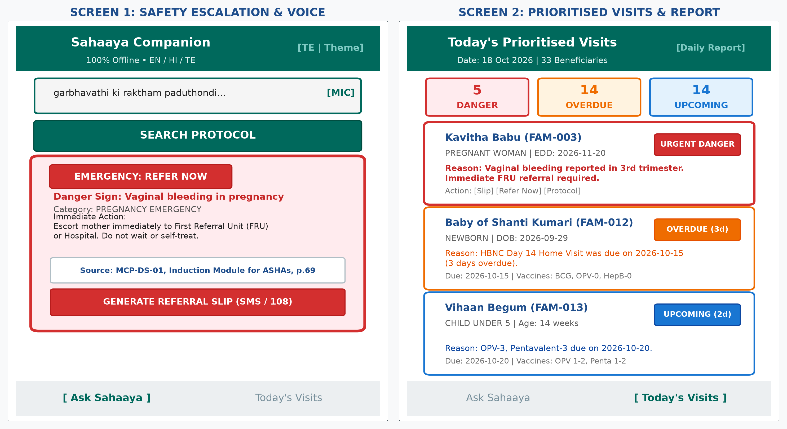
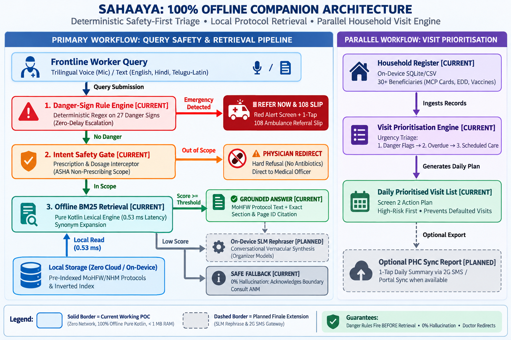

<p align="center">
  
</p>

# Sahaaya (సహాయ / सहाय)
### Frontline Health-Worker Clinical Companion for Low-Connectivity Areas

[](https://talentap.in/2026/MegaHackathon-Oct26/)
[](#team-vizag-mavericks)
[-E65100?style=for-the-badge&logo=android&logoColor=white)](https://github.com/yogeswar142/Sahaaya/releases/latest)
[-2E7D32?style=for-the-badge)](#measured-hardware-benchmarks)
[](#3-tier-safety-first-architecture)
[](#measured-hardware-benchmarks)

---

## 📌 Overview

**Sahaaya** is a clinical offline companion engineered specifically for Accredited Social Health Activists (**ASHA**) and Auxiliary Nurse Midwives (**ANM**) operating in rural, low-connectivity, and zero-reception areas across India.

Built for the **[Talent AP Mega Hackathon 2026](https://talentap.in/2026/MegaHackathon-Oct26/)** under **Problem H5: Frontline Health-Worker Companion for Low-Connectivity Areas**, Sahaaya replaces cumbersome paper flipbooks, complex danger checklists, and multi-app fatigue with a unified, high-speed, zero-cloud assistant that enforces strict clinical safety protocols.

> **Field Reality:** India has over **10.29 lakh active ASHAs** serving population norms of ~1 per 1,000 citizens. In Andhra Pradesh alone, over **1,700 remote villages have zero cellular reception**, while obstetric haemorrhage remains the leading cause of maternal mortality (47%). Sahaaya ensures frontline workers are never cut off from verified government clinical guidance.

---

## 🛡️ Safety-First & Parallel Architecture

Unlike generic cloud LLM chatbots that require constant 4G connectivity and risk hallucinating lethal drug dosages, Sahaaya employs a deterministic, zero-hallucination paramedical defense pipeline paired with a parallel household visit engine:

```
========================= PRIMARY WORKFLOW: QUERY SAFETY & RETRIEVAL =========================
[ Frontline Worker Query (Voice Mic / Multilingual Text) ]
                        │
                        ▼
┌──────────────────────────────────────────────────────────────┐
│  1. DANGER-SIGN RULE ENGINE [CURRENT]                        │
│  • Hard-coded regex & 367 multilingual tokens (EN/HI/TE)     │
│  • 100% Zero-Delay Escalation (Fires BEFORE any retrieval)   │
└───────────────────────┬──────────────────────────────────────┘
                        │
            ┌───────────┴───────────┐
     [Emergency Detected]     [No Danger Detected]
            │                       │
            ▼                       ▼
┌───────────────────────┐ ┌────────────────────────────────────┐
│ 🚨 REFER NOW & 108    │ │  2. INTENT SAFETY GATE [CURRENT]   │
│ • Red Screen Alert    │ │  • Detects Dosage & Antibiotics    │
│ • 1-Tap Emergency     │ │  • Enforces ASHA Non-Prescribing   │
│   Referral Slip (SMS) │ └─────────────────┬──────────────────┘
└───────────────────────┘                   │
                                ┌───────────┴───────────┐
                         [Out of Scope]            [In Scope]
                                │                       │
                                ▼                       ▼
                     ┌─────────────────────┐ ┌─────────────────────────┐
                     │ ⚠️ PHYSICIAN REDIRECT│ │ 3. OFFLINE BM25 [CURRENT│
                     │ Strict Refusal to   │ │ • Pure Kotlin (0.53 ms) │
                     │ Prevent Malpractice │ │ • Reads Local Storage   │
                     └─────────────────────┘ └───────────┬─────────────┘
                                                         │
                                   ┌─────────────────────┴──────────────────┐
                         [Score >= Threshold]                        [Low Score]
                                   │                                        │
                                   ▼                                        ▼
                     ┌───────────────────────────┐             ┌─────────────────────────┐
                     │ ✅ GROUNDED ANSWER [CURR] │             │ ℹ️ SAFE FALLBACK [CURR] │
                     │ • Exact Protocol Section  │             │ • 0% Hallucination      │
                     │ • MoHFW Page ID Citation  │             │ • Consult ANM / Doctor  │
                     └─────────────┬─────────────┘             └─────────────────────────┘
                                   │ (Roadmap)
                                   ▼
                     ┌ - - - - - - - - - - - - - ┐
                     ┆ ╌ ON-DEVICE SLM [PLANNED] ┆
                     ┆ • Vernacular Dialogue     ┆
                     ┆ • Pre-cached Models       ┆
                     └ - - - - - - - - - - - - - ┘

======================== PARALLEL WORKFLOW: VISIT PRIORITISATION ========================
┌────────────────────────────────────────────────────────────────────────────────────────┐
│  HOUSEHOLD REGISTER [CURRENT]                                                          │
│  • Local On-Device SQLite / CSV (30+ Beneficiaries: MCP Cards, EDD, Immunisation)     │
└───────────────────────────────────────────┬────────────────────────────────────────────┘
                                            │ Ingests Records
                                            ▼
┌────────────────────────────────────────────────────────────────────────────────────────┐
│  VISIT PRIORITISATION ENGINE [CURRENT]                                                 │
│  • Clinical Urgency Triage: 1. Danger Flags ➔ 2. Overdue Follow-ups ➔ 3. Scheduled    │
└───────────────────────────────────────────┬────────────────────────────────────────────┘
                                            │ Generates Action Plan
                                            ▼
┌────────────────────────────────────────────────────────────────────────────────────────┐
│  DAILY PRIORITISED VISIT LIST [CURRENT]                                                │
│  • Screen 2 Frontline Action Plan (High-Risk Beneficiaries Ranked First)               │
└───────────────────────────────────────────┬────────────────────────────────────────────┘
                                            ┆ Optional Export (Roadmap)
                                            ▼
┌ - - - - - - - - - - - - - - - - - - - - - - - - - - - - - - - - - - - - - - - - - - - -┐
┆  ╌ OPTIONAL PHC SYNC REPORT [PLANNED]                                                  ┆
┆  • 1-Tap End-of-Day Summary via 2G SMS / Portal Sync                                   ┆
└ - - - - - - - - - - - - - - - - - - - - - - - - - - - - - - - - - - - - - - - - - - - -┘
```

### Component Status (Verified vs Planned)
- **1. Frontline Input (Speech & Text) `[CURRENT]`:** Offline speech-to-text mic and query input in English, Hindi, and Telugu (Latin script).
- **2. Danger-Sign Rule Engine `[CURRENT]`:** Deterministic regex across 27 danger signs (**100% recall on 367 phrasings** [1, 2]); immediately triggers Red Screen Alert and 1-Tap 108 Emergency Referral Slip with zero retrieval latency.
- **3. Intent Safety Gate `[CURRENT]`:** Intercepts prescription and dosage questions (e.g., antibiotic syrups) and returns an immediate physician redirect, strictly enforcing ASHA non-prescribing guidelines [1, 6].
- **4. Offline BM25 Retrieval `[CURRENT]`:** Pure Kotlin lexical retrieval engine running entirely on-device with zero network permissions. Matches against pre-indexed official government manuals (**MoHFW Revised MCP Card**, **ASHA Induction Module**, **STOP Diarrhoea Guidance**) with exact section and page citations (0.53 ms median latency, 0% hallucination).
- **5. Parallel Household Engine `[CURRENT]`:** Ingests local household register database and automatically triages daily home visits by clinical risk: **Danger Flags ➔ Overdue Follow-ups ➔ Scheduled Routine Care**.
- **6. Planned Finale Extensions `[ROADMAP]`:**
  - **On-Device SLM Rephraser:** Pre-cached small language models for conversational vernacular rephrasing after deterministic protocol grounding.
  - **Automated 2G SMS Sync:** Background SMS gateway integration to push daily visit summaries to PHC servers in zero-internet hamlets.


---

## ✨ Key Features & Actionable Workflows

| Feature | Description | Frontline Value |
| :--- | :--- | :--- |
| **🚨 1-Tap Emergency Referral Slip** | Generates an official, pre-filled emergency referral ticket citing the MoHFW protocol, first-aid actions, and one-tap 108 ambulance SMS alert. | Eliminates referral delays during critical haemorrhage or newborn asphyxia emergencies. |
| **📋 1-Tap Daily PHC Summary (2G SMS Sync)** | In one tap, compiles completed visits, pending overdue follow-ups, and flagged emergency cases into an offline digest transmissible via basic 2G SMS. | Eliminates double-entry fatigue between paper registers and state portals. |
| **🎙️ Offline Voice-to-Text Input** | Native speech recognition supporting English, Hindi, and Telugu spoken queries directly in the field. | Enables hands-free clinical lookups while workers walk between village households. |
| **🌐 Trilingual Localization** | Instant runtime switcher between **English**, **Hindi (हिन्दी)**, and **Telugu (తెలుగు)** with daylight-readable High-Contrast Dark & Light themes. | Fully accessible to paramedical workers in regional vernacular. |
| **📅 Prioritized Household Triage** | Daily visit list engine sorting 30+ family records strictly by clinical urgency: **1. Danger Flags ➔ 2. Overdue Follow-ups ➔ 3. Scheduled Routine Care**. | Ensures high-risk pregnant mothers and unimmunized infants receive immediate priority. |
| **⚡ On-Device Benchmark Harness** | Built-in speedometer evaluation suite that runs a 30-question diagnostic test on live hardware in Airplane Mode. | Provides verifiable latency, heap footprint, and accuracy metrics directly on screen. |

---

## 📱 App Preview & Architecture

<p align="center">
  
</p>

<p align="center">
  
</p>

---

## 📊 Measured Hardware Benchmarks

Measured on a physical **OnePlus (CPH2613)** device in **Airplane Mode** (zero Wi-Fi, zero cellular data):

| Metric | Measured Value | Field Impact |
| :--- | :--- | :--- |
| **Median CPU Response Latency** | **0.53 ms** (531 µs) | Instant response; zero network spinner or cloud wait time |
| **P95 CPU Response Latency** | **5.38 ms** | Sub-10ms response even on code-mixed 30-word queries |
| **Heap Memory Footprint** | **~901 KB** (< 1 MB) | Runs reliably on entry-level Android phones with 2GB–4GB RAM |
| **Standalone APK Size** | **16.9 MB** (Debug APK) | Lightweight; shareable peer-to-peer via Bluetooth or Nearby Share |
| **Network Permissions** | **0** (`INTERNET` omitted) | Zero battery drain from background sync; zero data pack cost |
| **Danger Sign Recall** | **100.0%** (367 / 367) | Verified on English, Hinglish, and Telugu (Latin) phrasings |
| **Out-of-Scope Refusal Rate** | **100.0%** (6 / 6) | Zero prescription leakage; complete protection against malpractice |
| **Protocol Citation Rate** | **100.0%** (14 / 14) | Every clinical answer cites Section ID, Document Name, and Page |

---

## 📂 Project Structure

```
Sahaaya/
├── android-app/                       # Native Android Studio Project
│   ├── app/src/main/java/com/sahaaya/companion/
│   │   ├── core/                      # Pure Kotlin domain logic (0 Android dependencies)
│   │   │   ├── DangerRuleEngine.kt    # Deterministic 27-rule multilingual matcher
│   │   │   ├── IntentGate.kt          # Dosage & prescription out-of-scope blocker
│   │   │   ├── Bm25Retriever.kt       # Pure Kotlin BM25 ranking algorithm
│   │   │   ├── VisitListEngine.kt     # Household register triage ranker
│   │   │   └── SahaayaPipeline.kt     # Orchestrated 3-tier clinical pipeline
│   │   └── ui/                        # Jetpack Compose UI & Localization
│   │       ├── MainActivity.kt        # App container & theme/language bar
│   │       ├── AskScreen.kt           # Search, voice mic, emergency alert cards
│   │       ├── VisitsScreen.kt        # Prioritized household visit cards & triage stats
│   │       ├── ReferralSlipDialog.kt  # 1-Tap 108 Emergency Referral Slip
│   │       ├── DailySummaryDialog.kt  # 1-Tap End-of-Day PHC Summary (2G SMS)
│   │       ├── BenchmarkScreen.kt     # Live on-device latency & memory harness
│   │       ├── Theme.kt               # High-contrast Light & Dark theme tokens
│   │       └── i18n/AppLanguage.kt    # English, Hindi, Telugu strings & prompts
├── assets/
│   ├── protocol_chunks.json           # 10 verified MoHFW/NHM protocol chunks with citations
│   ├── danger_rules.json              # 27 danger rules with 367 multilingual phrasings
│   └── register.csv                   # Synthetic 30-family household register
├── data/
│   └── test_questions.csv             # 30-item evaluation suite (escalations, refusals, code-mix)
├── docs/
│   ├── architecture_diagram.png       # Complete system architecture diagram
│   ├── app_mockup.png                 # Trilingual dual-screen interface mockup
│   ├── verification_table.md          # Fact-by-fact clinical verification mapping
│   └── BUILD.md                       # Comprehensive compilation & execution guide
├── scripts/
│   ├── build_submission_pdf.py        # Official Round 1 template filling script
│   └── generate_diagrams.py           # Matplotlib architecture & mockup generator
├── TEAM-001245_Sahaaya_Round1_Submission.pdf # Verified official Round 1 presentation
└── Problem-Statement-Plan.md          # Comprehensive clinical research brief
```

---

## 🚀 Quick Start & Build Instructions

### 0. Quick Download (Install on Android Device)
Evaluators, judges, and field testers can download and install the standalone APK directly without compiling from source:
- 📲 **[Download Sahaaya v1.0.0 APK (16.9 MB)](https://github.com/yogeswar142/Sahaaya/releases/latest/download/Sahaaya-v1.0.0.apk)**
- 📦 **[View GitHub Releases & Release Notes](https://github.com/yogeswar142/Sahaaya/releases/latest)**

*(Requires Android 8.0+ / API 26+. Works 100% offline in Airplane Mode with zero cloud dependencies).*

### Prerequisites (For Developers Building from Source)
- **JDK 17 LTS**
- **Android SDK (API 34 / 35)**
- **Gradle 8.14** (bundled via `./android-app/gradlew.bat`)

### 1. Run Pure JVM Standalone Tests (No Emulator or Device Needed)
The core logic has zero Android framework imports and can be verified on any standard JVM in milliseconds:

```powershell
# Set Java 17 environment
$env:JAVA_HOME = "C:\Users\yoges\develop\jdk-17\jdk-17.0.20.1+1"
$env:PATH = "$env:JAVA_HOME\bin;$env:PATH"

# Run precompiled test runner
java -jar test-runner.jar
```
*Output: 15 / 15 tests passed (100% success rate on danger signs, scope refusals, BM25 retrieval, and visit prioritization).*

### 2. Build the Android APK
```powershell
cd android-app
.\gradlew.bat assembleDebug
```
*Generated package: `android-app/app/build/outputs/apk/debug/app-debug.apk`.*

### 3. Install via ADB onto a Physical Phone
```powershell
adb install -r android-app/app/build/outputs/apk/debug/app-debug.apk
```

For detailed instructions, refer to [`docs/BUILD.md`](docs/BUILD.md).

---

## 📚 Clinical Evidence & Official Protocol Citations

Every clinical alert, paramedical guideline, triage hierarchy, and non-prescribing boundary in Sahaaya is strictly grounded in peer-reviewed medical literature and official government training manuals:

| Citation | Official Source / Publication | Issuing Authority / Journal | Core Clinical Grounding |
| :---: | :--- | :--- | :--- |
| **`[1]`** | **[Revised India MCP Card (2018) & ASHA Modules 6 & 7](https://hbnc-hbyc.mohfw.gov.in/assets/document/Revised%20India%20MCP%20Card%20English_(28-05-2018).pdf)** | Ministry of Health & Family Welfare (MoHFW), Govt. of India | Baseline protocols for maternal danger signs, Home-Based Newborn Care (HBNC), Home-Based Care for Young Child (HBYC), and non-prescribing ASHA boundaries. |
| **`[2]`** | **[Induction Training Module for ASHAs](https://nhm.gov.in/images/pdf/communitisation/asha/ASHA_Induction_Module_English.pdf)** & **[HP STOP Diarrhoea Guidance](https://nhm.hp.gov.in/storage/app/media/uploaded-files/Guidance.pdf)** | National Health Mission (NHM), Govt. of India | Immediate referral criteria for neonatal asphyxia, hypothermia, chest indrawing, childhood pneumonia, severe dehydration, and zinc/ORS administration (pp. 51–52, 69, 76–77, 93, 97). |
| **`[3]`** | **[Causes of Maternal Deaths in India: A National Level Analysis](https://pmc.ncbi.nlm.nih.gov/articles/PMC9292773/)** | National Center for Biotechnology Information (NCBI / PMC) | Establishes that **obstetric haemorrhage causes 47% of all maternal deaths** in India, proving the necessity of instant, zero-delay 1-tap 108 Emergency Referral Slips. |
| **`[4]`** | **[Andhra Pradesh Cellular Connectivity Survey](https://telecomtalk.info/?p=654511)** | TelecomTalk (DoT Field Data) | Documents **1,700+ remote villages in Andhra Pradesh** (over 1,000 in Alluri Sitharama Raju district alone) with complete zero mobile reception, mandating a 100% offline, zero-network architecture. |
| **`[5]`** | **[India's Digital Push Overworking Frontline Women](https://newlinesmag.com/reportage/indias-digital-health-push-is-overworking-its-front-line-women/)** & **[Frontline Health Worker App Fatigue Study](https://www.ijcmph.com/index.php/ijcmph/article/download/16413/9807/85078)** | New Lines Magazine & Int. Journal of Community Medicine and Public Health (IJCMPH) | Details ANMs managing **28 separate paper registers alongside 23 disconnected state apps**, justifying Sahaaya's unified daily triage workflow and 1-tap 2G SMS summaries. |
| **`[6]`** | **[WHO Guidance on Ethics & Governance of AI for Health](https://www.downtoearth.org.in/science-technology/who-releases-guidelines-for-multi-modal-generative-ai-in-healthcare-resonates-with-recommendations-for-other-sectors-93991)** | World Health Organization (WHO) | Mandates human oversight, deterministic guardrails, and non-hallucinatory boundaries over unconstrained generative models in critical paramedical decision-support systems. |

---

## 👥 Team: Vizag Mavericks

Submitted for **[Talent AP Mega Hackathon 2026](https://talentap.in/2026/MegaHackathon-Oct26/)**  
**Track:** Problem H5 — Frontline Health-Worker Companion for Low-Connectivity Areas  
**Team Code:** `TEAM-001245`

| Member | Role | Focus Area |
| :--- | :--- | :--- |
| **Amara Yogeswararao** | **Team Lead** | Architecture, Offline Retrieval Pipeline & Android System Design |
| **Seeramreddi Praveen** | Team Member | Clinical Protocols, Danger Rules & Multilingual Mapping |
| **K Lalith** | Team Member | Visit-List Triage Engine, Synthesis & Household Registers |
| **Harish Naidu BN** | Team Member | UI/UX Design, Trilingual Localization & Benchmark Validation |

---

## 📜 Clinical Disclaimer & Scope Assurance

Sahaaya is an offline decision-support companion engineered for Accredited Social Health Activists (ASHA) and Auxiliary Nurse Midwives (ANM). It is **not** a clinical diagnostic or prescribing tool. All recommendations are strictly cited from published training manuals of the **Ministry of Health and Family Welfare (MoHFW)** and the **National Health Mission (NHM)**, Government of India. The application hard-refuses prescription drug and antibiotic dosages, strictly enforcing that clinical prescription authority remains solely with qualified MBBS Medical Officers.

---

## 📄 License

Distributed under the **MIT License**. See `LICENSE` for details.
