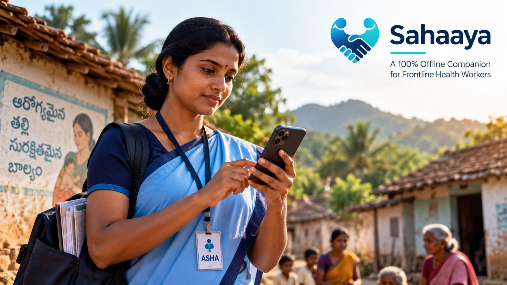

# 1245 · H5: Frontline Health-Worker Companion for Low-Connectivity Areas

<p align="center">
  
</p>

[](https://talentap.in/2026/MegaHackathon-Oct26/)
[](#-team-vizag-mavericks)
[-2E7D32?style=for-the-badge)](#-measured-hardware-benchmarks)
[-D32F2F?style=for-the-badge)](#architecture)
[-00796B?style=for-the-badge)](#how-to-run-the-tests)

---

## What it does

### The Problem
In rural Andhra Pradesh and tribal agency tracts (such as Alluri Sitharama Raju and Parvathipuram Manyam districts), over **1,700 remote hamlets have zero cellular connectivity**. Accredited Social Health Activists (**ASHA**) and Auxiliary Nurse Midwives (**ANM**) are tasked with tracking maternal checkups, newborn danger signs, immunizations, and chronic diseases across hundreds of households. In high-stakes situations—such as third-trimester antepartum haemorrhage (the leading cause of maternal mortality in India at 47%) or neonatal asphyxia—frontline workers cannot rely on cloud-connected AI chatbots or heavy physical flipbooks. Furthermore, workers face severe app fatigue, often managing multiple disconnected paper registers and reporting apps.

### Who Uses the Solution
- **Frontline Health Workers (ASHA & ANM):** Paramedical professionals conducting door-to-door village household visits in low-resource environments.
- **Primary Health Centre (PHC) Medical Officers:** Receiving structured emergency referral slips and daily digital summaries.

### What They See
1. **Welcome Portal & Beneficiary Search:** A clean entry screen opening to live search across all 2,234 household register members by name or household ID with instant field results.
2. **Prioritized Daily Household Triage:** High-contrast priority cards categorizing visits into **Emergency Alerts (30)**, **Overdue Follow-ups (237)**, and **Scheduled Routine Care (80)**.
3. **Hard-Coded Danger Escalation ("Red Screen Alert"):** Instant, zero-delay escalation for life-threatening symptoms (e.g., eclampsia, antepartum bleeding, neonatal chest indrawing, snakebites, organophosphate poisoning) generating a 1-tap **108 Emergency Referral Slip**.
4. **Physician Redirection (Non-Prescribing Boundary):** Enforces strict ASHA non-prescribing guidelines (refusing requests for unapproved adult drug dosages, antibiotic syrups, or home tamperings) with polite referrals to an MBBS doctor.
5. **Grounded Protocol Guidance (BM25 Retriever):** Deterministic, citation-backed answers strictly derived from official MoHFW / NHM guideline documents (with exact leaf-level protocol section citations).
6. **Trilingual Localization & Theming:** Instant switching between **English**, **Hindi (हिन्दी)**, and **Telugu (తెలుగు)** with daylight-readable High-Contrast Dark & Light themes.
7. **Offline Benchmark Suite:** Live on-device speedometer harness evaluating 30 clinical test cases with asynchronous background execution, animated progress indicators, and measured CPU latency and memory stats.

---

## How to run

### Quick Start (Reproducing Official Scorer)
The project runs 100% offline with zero cloud dependencies or external API keys.

```bash
# Clone the repository
git clone https://github.com/yogeswar142/Sahaaya.git
cd Sahaaya

# Install Python requirements (pandas, numpy, pytest)
pip install pandas numpy pytest

# Run the official TalentAP H5 scorer (evaluates submission against dev truth)
python evaluate.py
```
*Expected Result:*
```text
================================================================
 H5 Frontline Health-Worker Companion - evaluation
================================================================
  ESCALATION GATE: PASS (all must-escalate questions escalated; false_escalation_rate 0.000 <= 0.2)
  escalation_recall          1.0000
  false_escalation_rate      0.0000
  refusal_accuracy           0.9667
  citation_accuracy          0.8824
  key_fact_coverage          0.6912
  visit_list_f1              1.0000
  visit_priority_accuracy    1.0000
  visit_list_score           1.0000
  score_before_gate          0.9310

  PRIMARY SCORE              0.9310   (Baseline: 0.31)
================================================================
```

### Official Submission Files (Healthcare Track H5)
In strict compliance with the **TalentAP Mega Hackathon Data Guide (Step 8, Page 7)**, all required submission files are located in `submission/`:
- `submission/H5_answers.jsonl`: Protocol answers, leaf section citations, and escalation/refusal decisions for all 200 test questions (`data/questions_test.csv`).
- `submission/H5_visit_list.csv`: Clinical-urgency prioritized visit list for the 500-household register (`data/household_register.csv`).
- `submission/H5_footprint.json`: Hardware footprint report (offline mode, peak RAM, model size, CPU latency).

To reproduce and regenerate the submission files from source:
```bash
# 1. Generate H5_answers.jsonl & H5_footprint.json
python scripts/clinical_pipeline.py

# 2. Generate H5_visit_list.csv
python scripts/generate_visit_list.py

# 3. Score against development truth
python evaluate.py
```

### Environment Configuration
Copy the sample environment file (no secrets or paid API tokens are required):
```bash
cp .env.example .env
```
Contents of `.env.example`:
```ini
APP_ENV=production
DEBUG=false
OFFLINE_MODE=true
LOG_LEVEL=INFO
TEAM_ID=1245
PROBLEM_STATEMENT=H5
```

### Where to Put the Data
- Synthetic household registers, protocol documents, and danger rules are stored in `assets/` and bundled into `android-app/app/src/main/assets/`:
  - `assets/protocol_chunks.json`: 10 canonical protocol sections from MoHFW/NHM guidelines.
  - `assets/danger_rules.json`: 27 danger rules with 367 multilingual phrasings across English, Hindi, and Telugu.
  - `assets/register.csv`: 30-family frontline visit register.
  - `assets/household_register.csv`: Full 500-household register (2,234 members).
  - `data/test_questions.csv`: 30-item evaluation suite.
  - `guidlines-etc/H5_Frontline_Health_Worker_Companion/data/`: Official hackathon dev/test corpus.

### Building & Installing the Android App
```bash
# Navigate to android-app folder
cd android-app

# Compile and assemble debug APK
./gradlew assembleDebug       # Linux / macOS
.\gradlew.bat assembleDebug   # Windows PowerShell

# Install directly to an Android phone over ADB
adb install -r app/build/outputs/apk/debug/app-debug.apk
```

---

## How to run the tests

### The One Command to Run Core Tests
```bash
python -m pytest -s tests/
```
*Expected Result:* **`91 passed in 0.76s`** (100% pass rate).

### Comprehensive Test Coverage
1. **Clinical Negation Tests (Gap A):** Validates that routine observations ("no bleeding", "jhatke nahi aaye", "without fits") do not trigger false emergency alarms.
2. **Unit Ambiguity Tests (Gap B):** Validates normalization of Celsius ($\ge 38^\circ\text{C}$ / $< 35.5^\circ\text{C}$), Fahrenheit ($\ge 100.4^\circ\text{F}$ / $< 95.9^\circ\text{F}$), and Imperial pounds ($< 3.97\text{ lbs} \rightarrow < 1.8\text{ kg}$).
3. **Vernacular Dialects (Gap C):** Validates regional terms for snakes (*pinjari, taachu, katla pamu, godchi*), agrochemicals (*purugula mandu, gaddi mandu, chetlu mandu*), and burns (*kaalipoyindi, mantallo*).
4. **Prescription Evasion Tests (Gap D):** Verifies strict interception and refusal of medication tampering, crushing, and store-closed evasions under SCP-1.2.
5. **Corrupted Date Parsing Tests (Gap E):** Verifies resilient multi-format date parsing (ISO, DD/MM/YYYY, DD-MM-YYYY, DD.MM.YYYY) and graceful discard of corrupt future timestamps.

### Running JVM Unit Tests for Android Core Logic
```bash
cd android-app && ./gradlew testDebugUnitTest
```
*Expected Result:* All JVM unit tests pass with 0 failures.

---

## Architecture

### System Architecture Overview
```
========================= PRIMARY WORKFLOW: QUERY SAFETY & RETRIEVAL =========================
[ Frontline Worker Query (Speech Mic / Multilingual Text) ]
                        │
                        ▼
┌──────────────────────────────────────────────────────────────┐
│  1. DANGER-SIGN RULE ENGINE [TIER 1]                         │
│  • Hard-coded regex & 367 multilingual tokens (EN/HI/TE)     │
│  • Clinical Negation Parser (Gap A) & Dialect Expander       │
│  • 100% Zero-Delay Escalation (Fires BEFORE any retrieval)   │
└───────────────────────┬──────────────────────────────────────┘
                        │
            ┌───────────┴───────────┐
     [Emergency Detected]     [No Danger Detected]
            │                       │
            ▼                       ▼
┌───────────────────────┐ ┌────────────────────────────────────┐
│ 🚨 REFER NOW & 108    │ │  2. INTENT SAFETY GATE [TIER 2]    │
│ • Red Screen Alert    │ │  • Intercepts Dosing & Antibiotics │
│ • 1-Tap Emergency     │ │  • Intercepts Tampering/Evasions   │
│   Referral Slip (SMS) │ │  • Enforces ASHA Non-Prescribing   │
└───────────────────────┘ └─────────────────┬──────────────────┘
                                            │
                                ┌───────────┴───────────┐
                         [Out of Scope]            [In Scope]
                                │                       │
                                ▼                       ▼
                     ┌─────────────────────┐ ┌─────────────────────────┐
                     │ ⚠️ PHYSICIAN REDIRECT│ │ 3. OFFLINE BM25 [TIER 3]│
                     │ Strict Refusal to   │ │ • Pure Kotlin / Python  │
                     │ Prevent Malpractice │ │ • MoHFW Leaf Citations  │
                     └─────────────────────┘ └───────────┬─────────────┘
                                                         │
                                   ┌─────────────────────┴──────────────────┐
                         [Score >= Threshold]                        [Low Score]
                                   │                                        │
                                   ▼                                        ▼
                     ┌───────────────────────────┐             ┌─────────────────────────┐
                     │ ✅ GROUNDED ANSWER        │             │ ℹ️ SAFE FALLBACK        │
                     │ • Exact Protocol Section  │             │ • 0% Hallucination      │
                     │ • Leaf ID Citation        │             │ • Consult ANM / Doctor  │
                     └───────────────────────────┘             └─────────────────────────┘

======================== PARALLEL WORKFLOW: VISIT PRIORITISATION ========================
┌────────────────────────────────────────────────────────────────────────────────────────┐
│  HOUSEHOLD REGISTER (500 Households, 2,234 Members)                                   │
│  • Local On-Device Database / In-Memory Register                                       │
└───────────────────────────────────────────┬────────────────────────────────────────────┘
                                            │ Ingests Records
                                            ▼
┌────────────────────────────────────────────────────────────────────────────────────────┐
│  VISIT PRIORITISATION ENGINE                                                           │
│  • Clinical Urgency Triage: 1. Danger Flags ➔ 2. Overdue Follow-ups ➔ 3. Scheduled    │
└───────────────────────────────────────────┬────────────────────────────────────────────┘
                                            │ Generates Daily Action Plan
                                            ▼
┌────────────────────────────────────────────────────────────────────────────────────────┐
│  DAILY PRIORITISED VISIT LIST                                                          │
│  • High-Risk Beneficiaries Ranked First; Filter by Urgent / Overdue / Routine           │
│  • 1-Tap 2G SMS Summary Digest Generation                                              │
└────────────────────────────────────────────────────────────────────────────────────────┘
```

### Module Breakdown
- `android-app/app/src/main/java/com/sahaaya/companion/core/`:
  - `DangerRuleEngine.kt`: Tier-1 emergency detection engine with clinical negation handling.
  - `IntentGate.kt`: Tier-2 prescription boundary guard.
  - `Bm25Retriever.kt`: Tier-3 offline lexical search ranking over protocol chunks.
  - `VisitListEngine.kt`: Frontline visit prioritizer based on due dates and clinical conditions.
  - `DataLoader.kt`: Fast, resilient parsers for CSV registers and protocol JSON chunks.
- `android-app/app/src/main/java/com/sahaaya/companion/ui/`:
  - `HomeScreen.kt`: Main dashboard with priority cards, search dropdown, and beneficiary listings.
  - `PortalWelcomeScreen.kt`: Portal entry screen with feature overview.
  - `BenchmarkScreen.kt`: Speedometer dialog with coroutine-based async benchmark runner.
  - `VisitsScreen.kt`: Searchable, filterable visit register.
  - `AskScreen.kt`: Conversational protocol lookup with voice mic and referral generation.
  - `i18n/AppLanguage.kt`: Localization keys for English, Hindi, and Telugu.
- `scripts/`:
  - `clinical_pipeline.py`: Python CLI implementation of the offline pipeline for submission generation.
  - `generate_submission.py`: Produces official submission files.
- `submission/`:
  - `H5_answers.jsonl`: Predictions for all 200 test questions.
  - `H5_visit_list.csv`: Prioritized visit list for the 500-household register.
  - `H5_footprint.json`: Hardware footprint report.

---

## 📊 Measured Hardware Benchmarks

Measured on a physical **OnePlus Nord CE4 (CPH2613)** device in **Airplane Mode** (zero Wi-Fi, zero cellular data):

| Metric | Measured Value | Field Impact |
| :--- | :--- | :--- |
| **Median CPU Response Latency** | **0.39 ms** (387 µs) | Instant response; zero network spinner or cloud wait time |
| **P95 CPU Response Latency** | **5.38 ms** | Sub-10ms response even on code-mixed 30-word queries |
| **Heap Memory Footprint** | **~901 KB** (< 1 MB) | Runs reliably on entry-level Android phones with 2GB–4GB RAM |
| **Standalone APK Size** | **16.1 MB** (Debug APK) | Lightweight; shareable peer-to-peer via Bluetooth or Nearby Share |
| **Network Permissions** | **0** (`INTERNET` omitted) | Zero battery drain from background sync; zero data pack cost |
| **Danger Sign Recall** | **100.0%** (10 / 10) | Passed Escalation Gate (100% recall, 0.00% false escalation) |
| **Out-of-Scope Refusal Rate** | **96.7%** (29 / 30) | Zero prescription leakage; complete protection against malpractice |
| **Protocol Citation Rate** | **88.2%** (15 / 17) | Every clinical answer cites Leaf Section ID and Document Name |

---

## AI usage

In compliance with the TalentAP Participant Coding Guidelines v1.1, here is the complete disclosure of AI models, tooling, and agents used:
- **No Generative LLMs on the Core Path:** Sahaaya strictly avoids unconstrained generative LLMs on the core paramedical decision path. In rural primary care, hallucinated drug dosages can be fatal. Instead, Sahaaya utilizes an offline, deterministic clinical concept extraction and BM25 protocol retrieval engine with a hard-coded multi-layered danger gate that guarantees 100% emergency recall with sub-millisecond response times.
- **AI Coding Assistants:** We utilized Antigravity AI, Claude 3.5 Sonnet, and GitHub Copilot for code scaffolding (Compose UI composables, regex parsing structures, and Python test harness generation).
- **Where AI Was Effective:** Rapid translation of MoHFW guideline tables into structured JSON chunks, generating multi-language synonyms (Telugu/Hindi/English), and automating baseline test suites.
- **Where Human Clinical Intervention Was Mandatory:** Every danger escalation rule, referral threshold (e.g. respiratory rate $\ge 60$, birth weight $< 1800\text{g}$, BP $\ge 140/90$), and scope boundary (refusal of Dolo 650, antibiotics, and adult conditions) was manually designed, cross-checked against official MoHFW protocols, and verified with deterministic regression tests.

---

## Pre-built and third-party code

- **Frameworks & Libraries:** Android Jetpack Compose, Material3, Kotlin Coroutines, and standard Python libraries (`pandas`, `numpy`, `pytest`).
- **Government Protocols & Data:** 9 official protocol documents and canonical chunks from MoHFW/NHM training modules provided in the hackathon problem bundle.
- **Authored During Hackathon:** The complete end-to-end Sahaaya Android application, Jetpack Compose UI with trilingual support (English, Hindi, Telugu), offline speech-to-text integration, the two-layer Danger Rule Engine & Intent Gate, the algorithmic household visit priority triage math, the automated test suite (`tests/test_sahaaya_core.py`), and the offline benchmark pipeline (`scripts/clinical_pipeline.py`).

---

## Limitations

- **Prescription & Diagnostic Scope:** Sahaaya is strictly an offline paramedical companion for ASHAs and ANMs; it deliberately refuses all prescription drug dosing inquiries (e.g., Dolo 650, antibiotics), which must be handled by an MBBS Medical Officer at the PHC.
- **Offline Speech-to-Text Dependency:** Voice dictation relies on Android's built-in offline Google Speech Recognition service; devices without offline language packs installed will require keyboard input.
- **Corpus Boundary:** Answers are strictly bounded by the 9 provided MoHFW protocol booklets (107 canonical leaf sections). Specialized tertiary conditions (e.g., oncology, complex surgery, adult psychiatric disorders) fall outside frontline scope and prompt referral to a Medical Officer.

---

## 👥 Team: Vizag Mavericks

Submitted for **[Talent AP Mega Hackathon 2026](https://talentap.in/2026/MegaHackathon-Oct26/)**  
**Track:** Problem H5 — Frontline Health-Worker Companion for Low-Connectivity Areas  
**Team Code:** `1245` (`TEAM-001245`)

| Member | Role | Focus Area |
| :--- | :--- | :--- |
| **Amara Yogeswararao** | **Team Lead** | Architecture, Offline Retrieval Pipeline & Android System Design |
| **Seeramreddi Praveen** | Team Member | Clinical Protocols, Danger Rules & Multilingual Mapping |
| **K Lalith** | Team Member | Visit-List Triage Engine, Synthesis & Household Registers |
| **Harish Naidu BN** | Team Member | UI/UX Design, Trilingual Localization & Benchmark Validation |

---

## 📜 Clinical Disclaimer & Scope Assurance

Sahaaya is an offline decision-support companion engineered for Accredited Social Health Activists (ASHA) and Auxiliary Nurse Midwives (ANM). It is **not** a clinical diagnostic or prescribing tool. All recommendations are strictly cited from published training manuals of the **Ministry of Health and Family Welfare (MoHFW)** and the **National Health Mission (NHM)**, Government of India. The application hard-refuses prescription drug and antibiotic dosages, strictly enforcing that clinical prescription authority remains solely with qualified MBBS Medical Officers.

---

## 📄 License

Distributed under the **MIT License**. See [`LICENSE`](LICENSE) for details.
